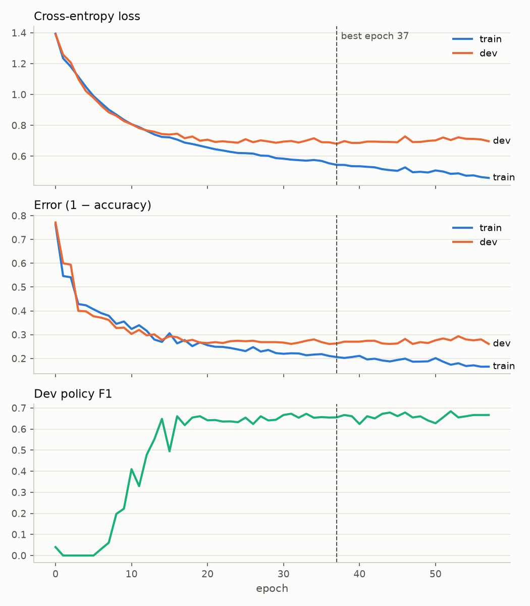
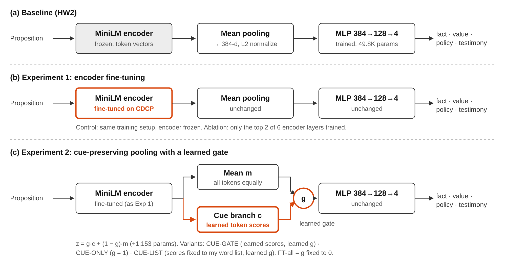

# AI Action Plan RFI — a reader for 755 organizational submissions

A web-based reader for the 755 organizational responses to the AI Action Plan
RFI ([90 FR 9088](https://www.federalregister.gov/documents/2025/02/06/2025-02305/request-for-information-on-the-development-of-an-artificial-intelligence-ai-action-plan)).
HW1 made them readable and taggable paragraph by paragraph. **HW2 adds a neural
network that labels every sentence as _policy_, _value_, _fact_ or
_testimony_**, so a reader can see where an organization asks the government
to act. HW3 (§9) tests two modifications aimed at the value sink: encoder
fine-tuning and cue-preserving pooling with a learned gate.
**DS 7400, Fall 2026 — HW2, HW3.**

## 1. Application features and UI

**Corpus tab** — the HW1 reader: search and `ORG TYPE` / `TOPIC` filter chips
on top, the list of submissions on the left, the selected submission on the
right in numbered paragraphs, with the tag box at the foot (§8). New in HW2:

- **Predicted sentence types.** Opening a submission runs the network on all of
  its sentences (`GET /predict/document/{doc_id}`; usually well under a second).
  **Policy** sentences are shaded; hover any sentence for its type and
  probabilities. With the backend off, stored predictions are shown instead.
- **Show predicted types** toggle — hides all predictions, for hand-coding.

**Model tab**

- **Training monitor** — the served model's loss and error per epoch, and its train / dev / test results.
- **Interactive training** — pick a learning rate, epochs and class weight, press **Train** (§3).
- **Try the model on any text.** Paste text, press **Predict** (`POST
  /predict`): the sentences come back shaded, with a table of probabilities.
  This is for text outside the corpus — a sentence from the Action Plan
  itself, or one demand rephrased several ways — to see what the network
  responds to.

## 2. The model

| | |
|---|---|
| Unit | **one sentence** — a paragraph mixes types, a sentence has one |
| Input | the sentence's embedding from **all-MiniLM-L6-v2** (384 numbers), frozen |
| **Network** | `Linear(384 → 128) → ReLU → Dropout(0.2) → Linear(128 → 4)`, 49,796 weights |
| Training data | **CDCP** (Park & Cardie, 2018): citizen comments on a CFPB rule. Train 2,742 · dev 525 · test 836 |

**Why CDCP.** It is the closest public, gold-labeled corpus of comments
submitted to U.S. federal policymaking that I could find, with published
train / dev / test splits, and its policy label — a proposition proposing a
course of action — is what this project means by a demand. Its comments differ
from the RFI in who wrote them (citizens, not organizations) and what about
(debt collection, not AI); §4 measures what that difference costs.

**Training loop** (`training/train.py`, written out by hand): (1) initialize —
seed, Kaiming / Xavier weights, cross-entropy, plain SGD; (2) forward a batch
of 32; (3) loss; (4–5) `zero_grad()` and `loss.backward()`; (6) update
`w ← w − lr × gradient`; (7) repeat, keeping the epoch with the lowest dev loss
and stopping after 20 epochs without improvement. Settings were chosen on
**dev only** (`training/sweep.py`): lr 0.1, no class weighting. Test was scored once.



| CDCP test (836 sentences) | Error | Macro-F1 | Policy F1 |
|---|---|---|---|
| Always predict `value` | 0.476 | — | — |
| **TF-IDF + logistic regression (benchmark)** | 0.327 | 0.615 | 0.71 |
| MiniLM + logistic regression | 0.291 | 0.640 | 0.59 |
| **MiniLM + our network** | **0.292 ± 0.005** (3 seeds) | 0.653\* | 0.62\* [0.52, 0.72] |

\* saved model (seed 0). Dev loss flattens around epoch 20 while train loss keeps
falling; early stopping kept epoch 37 (train error 0.206, dev error 0.263).

- **It beats the benchmark on error** by 3.5 points — but logistic regression on
  the same embeddings does as well: **the gain is the encoder's.**
- **It is weaker on policy:** 69% of missed policy sentences become `value`.
  MiniLM encodes what a sentence is about better than how it is said.

## 3. Interactive training and the monitor

`backend/train_api.py` serves the monitor and runs `train()` from `training/train.py`
in a background thread. Runs save to `training/runs/`; the served model is never
replaced and test is never scored.

## 4. On the RFI: unvalidated, and why

No RFI sentence has a checked label yet, so RFI predictions are **unvalidated demo
output**. What can be measured without labels says the transfer is poor:

| | MiniLM + our network | TF-IDF + LogReg |
|---|---|---|
| RFI sentences predicted policy (CDCP: 11–12%) | **5.2%** | 7.0% |
| *should / must / need to / require* sentences → policy, CDCP dev | 66% | 70% |
| — the same on the RFI | **19%** | **49%** |

Sources: `training/results/rfi_policy_share.json`, `rfi_transfer_tfidf.json`. The *should/must* comparison is a
heuristic, not accuracy. The sentences are picked by those words and TF-IDF
sees the words themselves, so its 49% partly reflects how the set was chosen.

- **The network misses most organizational demands.** *"The government should
  modernize FedRAMP by establishing a faster, criteria-based path for approval
  of AI tools."* (OpenAI submission) → value, policy 0.04.
- **The network drops more than the benchmark on this cue; a likely reason is
  that MiniLM weighs topic heavily and "should" lightly.**
- Lowering the threshold for "policy" would not fix it on its own: the missed
  demand above scores 0.04, and the predicted-policy set already holds noise
  such as a date line and footnote references.

## 5. The data

**RFI** — public records published by NITRD: 10,067 responses, **755 from
organizations**, 752 with extracted text; 31,384 paragraphs, 90,806 sentences.
`pipeline/data/` holds `documents.json`, `segments.json` (paragraphs as
offsets, in code points, `nfkc-v1`) and `fulltext/*.txt`. **Respondent type comes from
the docket. Topics** come from the [IFP database](https://www.aiactionplan.org), derived
by a language model: navigation only, **never fed to the model**. The 603 MB
source archive is on [NITRD](https://www.nitrd.gov/coordination-areas/ai/90-fr-9088-responses/).

**CDCP** — Park & Cardie (2018), *A Corpus of eRulemaking User Comments for
Measuring Evaluability of Arguments*, LREC. `training/fetch_cdcp.py` fetches it from
[HITSZ-HLT/GMAM](https://github.com/HITSZ-HLT/GMAM); it has no license, so **it is
not redistributed here**.

## 6. Running

Node.js 20+ and Python 3.11+. The viewer alone reads, tags and shows stored
predictions; live predictions and training need the backend, run from the
training environment (repository root, second terminal):

```bash
cd viewer && npm install && npm run dev     # http://localhost:5173
python3 -m venv training/.venv && training/.venv/bin/pip install -r training/requirements.txt
training/.venv/bin/uvicorn app:app --app-dir backend --port 8000
```

The HW1 backend (`backend/.venv` or its Dockerfile; see `backend/README.md`)
still runs everything from HW1; prediction and training then answer 503. To
reproduce the model (optional — the weights are committed; for the corpus itself
see `pipeline/README.md`):

```bash
training/.venv/bin/python training/fetch_cdcp.py      # CDCP (not committed)
training/.venv/bin/python training/sweep.py           # choose on dev, train, score test once
training/.venv/bin/python backend/predict_corpus.py   # every RFI sentence (~3 min)
```

## 7. Libraries

React 19 and Vite 8 (no UI, chart or state library) · FastAPI, Uvicorn,
Pydantic, SQLite · PyTorch, sentence-transformers
([all-MiniLM-L6-v2](https://huggingface.co/sentence-transformers/all-MiniLM-L6-v2),
Apache-2.0), pysbd · scikit-learn, NumPy, Matplotlib · `pdftotext`.

## 8. Annotation and backend (HW1)

Click a paragraph, type a tag, press `Enter` to save and move on; or select a
phrase to tag only that. Annotations are **stand-off** (offsets, a `scheme`, a
`coder`), stored by FastAPI over SQLite and in `localStorage`. HW2's predictions
use the same shape; its endpoints live in new modules, and HW1's are unchanged.

## 9. HW3: Break the Network (DS 7400)

The experiment summary (1–2 pages) is in `hw3/HW3_experiment_summary.pdf`. Per-experiment notes with
predictions recorded before each run are in `hw3/experiments/EXP-01.md` and `EXP-02.md`.

### Task and dataset

- **Task:** classify one argumentative unit (a sentence or clause) into one of four types:
  fact, value, policy, testimony. My research goal is to find demands (policy) in organizations'
  comments on the U.S. AI Action Plan RFI, which has no labels, so the classifier is trained on CDCP.
- **Dataset:** CDCP (Park & Cardie, LREC 2018): 731 public comments on a CFPB debt-collection rule,
  segmented into units and labeled by two human annotators per comment, with a third resolving
  conflicts (Krippendorff's α = 0.648 for unit type). `reference` units are dropped.
  Split: train 2,742 / dev 525 / test 836.
- **Data is not committed.** CDCP has no license file in its distribution, so the repo contains a
  fetch script instead: `training/fetch_cdcp.py`.

### Baseline (HW2)



Frozen `all-MiniLM-L6-v2` → mean pooling → L2 normalize → MLP 384→128 (ReLU, dropout 0.2) → 4.
Only the MLP is trained (49,796 parameters). Plain SGD, lr 0.1, batch 32, weight decay 1e-4,
unweighted cross-entropy, early stopping on dev loss (patience 20). Test error 0.292 ± 0.005.

**Problem: the value sink.** When unsure, the model defaults to value, the most frequent class
(45% of training data). On dev (seed 0) it sent 72% of missed policy (18/25), 55% of missed fact
(16/29) and 63% of missed testimony (15/24) sentences to value.

### Proposed modifications

#### Experiment 1: encoder fine-tuning (Figure b)

- Train every MiniLM weight on CDCP, keeping the data, split, head and loss.
- Fine-tuning needs a different setup: AdamW, encoder lr 1e-5 (chosen on dev loss from
  {1e-5, 2e-5, 3e-5, 5e-5, 1e-4}), head lr 1e-3, weight decay 0.01, 50-step warmup, early stopping
  on dev loss with patience 3, max 15 epochs.
- **Frozen-encoder control:** the same setup with the encoder frozen, to separate the effect of the
  setup from the effect of training the encoder.
- **Ablation:** train only the top 2 of 6 encoder layers.

#### Experiment 2: cue-preserving pooling with a learned gate (Figure c)

Built on the fine-tuned model. Only the pooling changes. From the token vectors h_t:

- mean branch: m = mean of h_t (the current pooling)
- cue branch: a_t = softmax_t(w · h_t) over word tokens ([CLS]/[SEP] excluded), c = Σ a_t h_t
- gate: g = sigmoid(W_g [m; c] + b), one value per sentence
- z = g·c + (1 − g)·m → L2 normalize → same head. CUE-GATE adds 1,153 parameters. CUE-ONLY adds 384
  and CUE-LIST 769.

| variant | cue scores | gate |
|---|---|---|
| CUE-GATE | learned | learned |
| CUE-ONLY | learned | fixed to 1 |
| CUE-LIST | fixed to my word list | learned |
| FT-all (reference) | – | fixed to 0 |

Word list for CUE-LIST, chosen before the run from my coding of dev errors:
should, must, required, need to, needs to, please, important, I, my, experience.

All conditions use seeds 0, 1, 2. Dev is used only for early stopping and the lr rule. Test is
scored once per final run.

### How to run

```bash
# environment
python3 -m venv training/.venv && training/.venv/bin/pip install -r training/requirements.txt

# data
training/.venv/bin/python training/fetch_cdcp.py

# Experiment 1 (lr grid, frozen-encoder control, top-2, FT-all, about 30 min on CPU)
caffeinate -i training/.venv/bin/python training/hw3_overnight.py   # macOS. Drop caffeinate elsewhere

# Experiment 2 (about 25 min on CPU). Needs Experiment 1's FT-all weights.
training/.venv/bin/python training/hw3_exp2.py occlusion
training/.venv/bin/python training/hw3_exp2.py check
training/.venv/bin/python training/hw3_exp2.py run
training/.venv/bin/python training/hw3_exp2.py analyze

# diagnostics used to form the hypotheses (no network training). frames.py needs Experiment 1.
training/.venv/bin/python hw3/diagnostics/diag.py
training/.venv/bin/python hw3/diagnostics/diag2.py
training/.venv/bin/python hw3/diagnostics/frames.py
```

Outputs: `training/results/hw3/` (Experiment 1), `training/results/hw3_exp2/` (Experiment 2),
`training/results/hw3_diag/` (diagnostics). Model weights go to `training/runs/` and are gitignored.
Files that contain CDCP text are gitignored (`training/results/hw3_diag/`,
`training/results/hw3/partC_*.json`, `training/results/hw3_exp2/occlusion.json`). Rerun the scripts
to regenerate them.
Per-run arrays (.npy) are not committed. The committed report.md already includes the near-tie
analysis and the t-SNE map. Regenerating those two sections requires rerunning Experiment 2 from
scratch.

### Main results

CDCP test set, mean ± std over 3 seeds.

| | HW2 | frozen-encoder control | top-2 | FT-all | CUE-GATE | CUE-ONLY | CUE-LIST |
|---|---|---|---|---|---|---|---|
| test error | 0.292 ± 0.005 | 0.290 ± 0.002 | 0.261 ± 0.011 | **0.223 ± 0.007** | 0.227 ± 0.007 | 0.226 ± 0.008 | 0.225 ± 0.009 |
| macro-F1 | 0.649 | 0.650 | 0.700 | **0.751** | 0.745 | 0.747 | 0.748 |
| policy F1 | 0.614 | 0.635 | 0.764 | **0.814** | 0.808 | 0.807 | 0.809 |
| testimony F1 | 0.749 | 0.746 | 0.756 | **0.808** | 0.802 | 0.805 | 0.808 |

- Experiment 1: the gain comes from training the encoder. The frozen-encoder control does not
  improve, and more trained layers help more. Missed policy sentences sent to value: 29 → 10 (seed 0).
- Experiment 2: no variant differs from FT-all beyond seed noise. Occlusion shows FT-all already
  reacts to "should". The CUE-LIST gate opens for policy cues (median 0.91) and stays shut for
  testimony sentences with list words (0.12).
- Cost: fine-tuning trains 22.6M parameters instead of 50K (about 22 s vs under 1 s per epoch on CPU).
- Not evaluated on the RFI (no gold labels). FT-all flags 73% of RFI sentences containing should, must,
  need to, ought to or require as policy, against 19% for HW2. Its precision there is unknown.

### Manual error coding

`hw3/coding/` holds my coding of 58 CDCP dev sentences (errors and contrast cases of FT-all, seed 0),
without sentence text. See `hw3/coding/README.md` for groups, tags and how to rebuild the sheet.

### What I learned

- Moving a decision boundary (class weights) cannot fix an intermixed representation. Changing the
  representation can.
- A control is what makes a gain attributable: without the frozen-encoder control, the optimizer
  change could have explained the result.
- Check whether a signal is already used before adding a mechanism to preserve it. Apart from policy,
  single words were not enough. Next, I would model relations between words and widen the unit to
  neighboring sentences or paragraphs.

### Limitations

One dataset and split. Encoder lr at the edge of the grid. Manual coding by a single coder, not blind
to labels or predictions.

## Limitations

- **Citizens → organizations:** RFI predictions are unvalidated and miss most demands (§4).
- **Unit mismatch:** CDCP is cut into clause-level propositions, the RFI into full sentences.
- **Small policy test set:** 93 sentences, so policy F1 is ±0.1.
- **PDF artifacts:** footnote markers leak into paragraphs ("1 of the art…"); three submissions have no text.

## AI use and code reference

**AI assistance:** This project was assisted with Claude Code.

- **Scripts & Documents** — On claude.ai I used Claude to discuss design
  decisions and to develop features presenting on the app. Under my direction,
  Claude Code wrote the training scripts and other codes needed for the
  project. README is also drafted by Claude, but reviewed manually.
- **What I decided:** the training data (CDCP), the research question, the unit
  of analysis, iteratively adjusting and choosing hyperparameters,
  decision-making considering final output of the project.
- Commits made with AI help carry a `Co-Authored-By: Claude` line.

**HW3:** I came up with the hypotheses myself, but developed the experiment
process iteratively with Claude Code, especially running the training after I
reviewed each plan.

**Borrowed code:** none copied from other projects. Libraries are used through
their public APIs (§7). The pretrained encoder is all-MiniLM-L6-v2 from
sentence-transformers; the CDCP data comes from the GMAM repository (§5).

## Licenses

Code: MIT (`LICENSE`) · Data: CC BY 4.0 (`LICENSE-DATA.md`) · Citation: `CITATION.cff` · CDCP and MiniLM keep their own terms.
