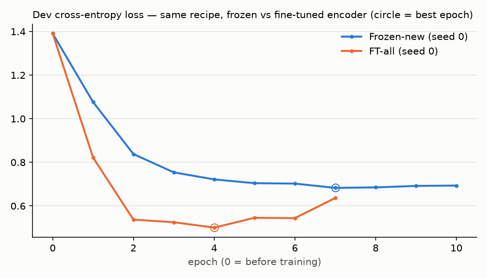

# EXP-01 — Fine-tuning the MiniLM encoder vs a frozen encoder

Code: `training/finetune.py`, `training/hw3_overnight.py` · results: `training/results/hw3/` (`summary.md`,
`summary.json`) · weights: `training/runs/hw3/` (gitignored) · diagnostics: `hw3/diagnostics/`

## Hypothesis

## Prediction

Recorded in the planning chat before the run on 2026-11-06;
this file was created afterwards on 2026-11-08.

Diagnostic predictions (before the checks)
- Probe (2026-11-01): It will detect well whether "should" is present or not. However, I'm not confident whether that cue has a critical impact on classifying the sentence as policy.
- Minimal pair (2026-11-05): "should" and "requires" will be similar, but "can" will be lower. Whether the sentence is policy will depend on the verb (modal).

Experiment 1 predictions (2026-11-06, before the run)
- First version: test error will increase, but fewer missed policy sentences will go to value.
- Reason: the encoder is already trained, so further training may cause errors early on.
- Revised before the run: the error will be unstable early, but the final test error will recover.
- Failure modes: other causes dominate (demands without modal words, the fact/value boundary). Overfitting (22.7M parameters, 2,742 sentences).

## Setup

- **Data:** CDCP train 2,742 / dev 525 / test 836 (4 classes; `reference` dropped).
- **Network:** MiniLM (`all-MiniLM-L6-v2`) → mean pooling → L2 normalize → HW2 head
  384 → 128 → ReLU → Dropout 0.2 → 4. Unweighted cross-entropy.
- **Four conditions:**

  | condition | what is trained | trainable parameters | optimizer |
  |---|---|---|---|
  | HW2 baseline | head only, on the cached frozen embedding | 49,796 | plain SGD, lr 0.1, wd 1e-4, patience 20, max 300 |
  | Frozen-new | head only, on the cached frozen embedding | 49,796 | FT recipe (below) |
  | FT-top2 | transformer layers 4–5 + head | 3,598,724 | FT recipe |
  | FT-all | every encoder weight + head | 22,615,172 | FT recipe |

  Frozen-new = frozen-encoder control (FT training setup, encoder frozen).
  FT recipe = the training setup listed below.

- **FT recipe:** AdamW, head lr 1e-3, encoder lr 1e-5, weight decay 0.01, linear warmup over 50 steps,
  batch 32, max 15 epochs, patience 3. Early stopping on dev loss, best epoch restored. Seeds 0, 1, 2.
- **HW2 baseline** = the HW2 setting re-trained in memory for seeds 0–2; nothing written to HW2 files.
- **Encoder lr** chosen by a rule fixed before the run: FT-all, seed 0, 4 epochs per lr; pick the lr whose
  lowest dev loss is lowest. Test never used. FT-top2 reuses FT-all's lr (no separate grid).

  | encoder lr | min dev loss | at epoch | dev error there | dev policy F1 there |
  |---|---|---|---|---|
  | 1e-05 **← chosen** | 0.5005 | 4 | 0.187 | 0.894 |
  | 2e-05 | 0.5226 | 4 | 0.187 | 0.898 |
  | 3e-05 | 0.5434 | 4 | 0.190 | 0.898 |
  | 5e-05 | 0.5541 | 2 | 0.210 | 0.887 |
  | 0.0001 | 0.5793 | 1 | 0.211 | 0.828 |

  The chosen lr is at the edge of the grid; the grid was not extended.
- **Selection:** all on dev. Test scored once per final run (3 seeds × 4 conditions).
- **Checks before the comparison:** the HW2 re-training reproduces `results/sweep.json` (all 3 seeds);
  seed 0 max |weight diff| vs `artifacts/model.pt` = 0; `finetune.SentenceEncoder` vs the HW2 cache
  max |diff| = 2.4e-07.
- Run 2026-11-06 23:35 to 2026-11-07 00:03 (28 min), unattended, on CPU.

## Result

**Test (CDCP, 836 sentences, mean ± std over seeds 0–2)** — from `summary.md`

| metric | HW2 baseline | Frozen-new | FT-top2 | FT-all |
|---|---|---|---|---|
| test error | 0.292 ± 0.005 | 0.290 ± 0.002 | 0.261 ± 0.011 | **0.223 ± 0.007** |
| macro-F1 | 0.649 ± 0.013 | 0.650 ± 0.008 | 0.700 ± 0.009 | **0.751 ± 0.003** |
| F1 fact | 0.463 ± 0.016 | 0.445 ± 0.030 | 0.489 ± 0.005 | **0.565 ± 0.005** |
| F1 policy | 0.614 ± 0.031 | 0.635 ± 0.013 | 0.764 ± 0.010 | **0.814 ± 0.006** |
| F1 testimony | 0.749 ± 0.005 | 0.746 ± 0.011 | 0.756 ± 0.007 | **0.808 ± 0.001** |
| F1 value | 0.771 ± 0.003 | 0.774 ± 0.005 | 0.792 ± 0.013 | **0.815 ± 0.012** |
| missed policy → value share | 0.698 ± 0.019 | 0.692 ± 0.055 | 0.477 ± 0.127 | 0.547 ± 0.015 |

Per-seed test errors (`summary.json` → `main.*.test_error`, seeds 0 / 1 / 2): HW2 0.293 / 0.297 / 0.287 ·
Frozen-new 0.287 / 0.292 / 0.291 · FT-top2 0.273 / 0.260 / 0.250 · FT-all 0.221 / 0.231 / 0.218.

**Missed policy on test** (93 gold policy sentences; seeds 0 / 1 / 2; counts from each run's confusion
matrix, `hw3/diagnostics/cost.py`)

| | missed | of which → value |
|---|---|---|
| HW2 baseline | 42 / 50 / 38 | 29 / 36 / 26 |
| Frozen-new | 42 / 35 / 41 | 30 / 22 / 30 |
| FT-top2 | 18 / 26 / 25 | 6 / 15 / 13 |
| FT-all | 18 / 17 / 18 | 10 / 9 / 10 |

**Runs** — from `summary.md`

| run | best epoch | stop | dev loss | dev error |
|---|---|---|---|---|
| frozen_seed0 | 7 | early_stop | 0.6829 | 0.263 |
| frozen_seed1 | 8 | early_stop | 0.6800 | 0.250 |
| frozen_seed2 | 12 | early_stop | 0.6760 | 0.269 |
| ft_top2_seed0 | 7 | early_stop | 0.5852 | 0.202 |
| ft_top2_seed1 | 6 | early_stop | 0.5810 | 0.210 |
| ft_top2_seed2 | 4 | early_stop | 0.5809 | 0.213 |
| ft_all_seed0 | 4 | early_stop | 0.5005 | 0.187 |
| ft_all_seed1 | 3 | early_stop | 0.5064 | 0.189 |
| ft_all_seed2 | 4 | early_stop | 0.4984 | 0.179 |

HW2 baseline best epochs: 37 / 33 / 30 (of max 300). Every run stopped by early stopping; frozen_seed2
ran all 15 epochs, but its best epoch (12) was 3 before the end, so it is not under-trained.

**Dev loss, seed 0** (`dev_loss_frozen_vs_ftall.png`; epoch 0 = untrained head)

| epoch | 0 | 1 | 2 | 3 | 4 | 5 | 6 |
|---|---|---|---|---|---|---|---|
| Frozen-new | 1.3905 | 1.0767 | 0.8379 | 0.7540 | 0.7217 | 0.7044 | 0.7024 |
| FT-all | 1.3905 | 0.8219 | 0.5373 | 0.5253 | **0.5005** | 0.5455 | 0.5442 |

FT-all's dev loss is lowest at epoch 4, then rises; it stops after epoch 7. Frozen-new is lowest at epoch 7
(0.6829).

**Cost** (CPU; seconds per epoch from the timestamps in `run.log`, via `hw3/diagnostics/cost.py`)

| condition | s / epoch | epochs run | seconds per run |
|---|---|---|---|
| Frozen-new | ≈ 0.1 | 10 / 11 / 15 | ≈ 2 |
| FT-top2 | 11.7 / 11.7 / 12.0 | 10 / 9 / 7 | 120 / 109 / 88 |
| FT-all | 23.1 / 22.2 / 21.3 | 7 / 6 / 7 | 165 / 137 / 153 |

## Interpretation

## Next
