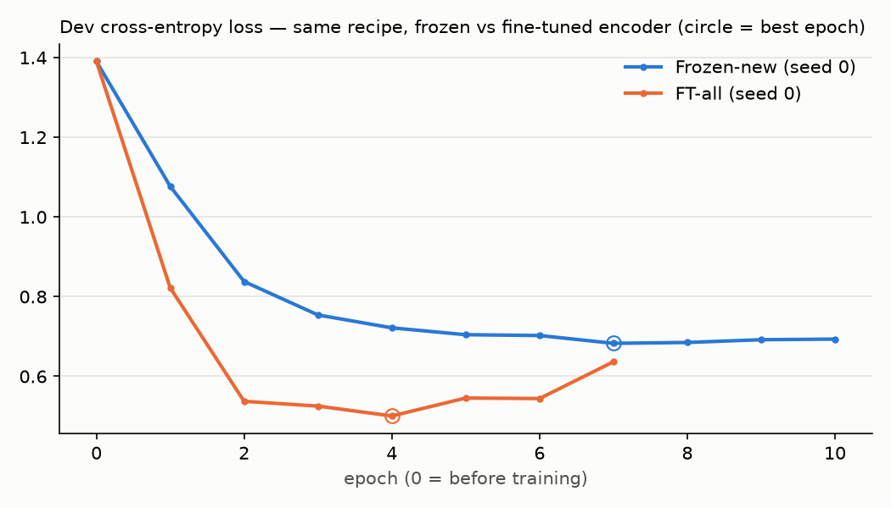

# HW3 overnight — fine-tuning vs frozen encoder
_Rebuilt 2026-11-07 00:03 after each step. All selection on CDCP dev; test scored once per final run. ± = std over seeds (ddof 1)._

## Step status

| step | state | minutes | note |
|---|---|---|---|
| 0_hw2_baseline | done | 0.2 | reproduces sweep.json: True; encoder vs cache 2.4e-07 |
| 1_lr_grid | done | 8.2 | chosen lr 1e-05 (grid edge) |
| 1.5_frozen_new | done | 0.1 | seeds 0, 1, 2 |
| 2_ft_all_seed0 | done | 2.8 | lr 1e-05 by rule (lowest dev loss, step 1) |
| 3_ft_all_seeds12 | done | 4.8 | lr 1e-05 by rule (lowest dev loss, step 1) |
| 4_ft_top2 | done | 5.3 | lr 1e-05 by rule (lowest dev loss, step 1) (FT-all's lr reused, no separate grid) |
| 5_rfi_rates | done | 5.9 | models: ft_all_seed2, ft_top2_seed2 |

## Main comparison (CDCP test, 836 sentences)

| metric | HW2 baseline (n=3) | Frozen-new (n=3) | FT-top2 (n=3) | FT-all (n=3) |
|---|---|---|---|---|
| test error | 0.292 ± 0.005 | 0.290 ± 0.002 | 0.261 ± 0.011 | 0.223 ± 0.007 |
| macro-F1 | 0.649 ± 0.013 | 0.650 ± 0.008 | 0.700 ± 0.009 | 0.751 ± 0.003 |
| F1 fact | 0.463 ± 0.016 | 0.445 ± 0.030 | 0.489 ± 0.005 | 0.565 ± 0.005 |
| F1 policy | 0.614 ± 0.031 | 0.635 ± 0.013 | 0.764 ± 0.010 | 0.814 ± 0.006 |
| F1 testimony | 0.749 ± 0.005 | 0.746 ± 0.011 | 0.756 ± 0.007 | 0.808 ± 0.001 |
| F1 value | 0.771 ± 0.003 | 0.774 ± 0.005 | 0.792 ± 0.013 | 0.815 ± 0.012 |
| missed policy → value share | 0.698 ± 0.019 | 0.692 ± 0.055 | 0.477 ± 0.127 | 0.547 ± 0.015 |

HW2 baseline = the HW2 setting (frozen MiniLM, SGD lr 0.1) re-trained in memory for seeds 0–2 and checked against `results/sweep.json`. Frozen-new = same frozen encoder, FT recipe (AdamW, head lr 1e-3, wd 0.01, warmup 50, patience 3, max 15).

### Runs

| run | trainable params | best epoch | stop | dev loss | dev error |
|---|---|---|---|---|---|
| frozen_seed0 | 49,796 | 7 | early_stop | 0.6829 | 0.263 |
| frozen_seed1 | 49,796 | 8 | early_stop | 0.6800 | 0.250 |
| frozen_seed2 | 49,796 | 12 | early_stop | 0.6760 | 0.269 |
| ft_top2_seed0 | 3,598,724 | 7 | early_stop | 0.5852 | 0.202 |
| ft_top2_seed1 | 3,598,724 | 6 | early_stop | 0.5810 | 0.210 |
| ft_top2_seed2 | 3,598,724 | 4 | early_stop | 0.5809 | 0.213 |
| ft_all_seed0 | 22,615,172 | 4 | early_stop | 0.5005 | 0.187 |
| ft_all_seed1 | 22,615,172 | 3 | early_stop | 0.5064 | 0.189 |
| ft_all_seed2 | 22,615,172 | 4 | early_stop | 0.4984 | 0.179 |

HW2 re-training reproduces sweep.json: True; seed 0 max |weight diff| vs artifacts/model.pt = 0.00e+00; SentenceEncoder vs cache max |diff| = 2.38e-07

## Dev loss: Frozen-new vs FT-all (seed 0)

## lr grid (FT-all, seed 0)

FT-all, seed 0, 4 epochs per lr; choose the lr whose lowest dev loss is lowest. Test never used.

| encoder lr | min dev loss | at epoch | dev error there | dev policy F1 there |
|---|---|---|---|---|
| 1e-05 **← chosen** | 0.5005 | 4 | 0.187 | 0.894 |
| 2e-05 | 0.5226 | 4 | 0.187 | 0.898 |
| 3e-05 | 0.5434 | 4 | 0.190 | 0.898 |
| 5e-05 | 0.5541 | 2 | 0.210 | 0.887 |
| 0.0001 | 0.5793 | 1 | 0.211 | 0.828 |

⚠️ chosen lr is at the edge of the grid.

## Part C — APPEND / PREPEND filler (seed 0 models)

Cell: mean P(policy) · P(testimony) · P(value) · still policy / n.

**Base set A — the HW2 model's 10 sentences**

| condition | HW2 baseline | Frozen-new | FT-top2 | FT-all |
|---|---|---|---|---|
| original | 0.83 · 0.01 · 0.13 · 10/10 | 0.78 · 0.01 · 0.17 · 10/10 | 0.95 · 0.00 · 0.04 · 10/10 | 0.95 · 0.00 · 0.04 · 10/10 |
| F1 APPEND | 0.63 · 0.02 · 0.31 · 8/10 | 0.57 · 0.03 · 0.37 · 7/10 | 0.85 · 0.02 · 0.12 · 9/10 | 0.74 · 0.06 · 0.19 · 9/10 |
| F1 PREPEND | 0.31 · 0.09 · 0.53 · 3/10 | 0.27 · 0.08 · 0.60 · 2/10 | 0.62 · 0.10 · 0.26 · 7/10 | 0.32 · 0.13 · 0.53 · 3/10 |
| F2 APPEND | 0.44 · 0.07 · 0.46 · 5/10 | 0.46 · 0.08 · 0.44 · 5/10 | 0.84 · 0.08 · 0.08 · 9/10 | 0.89 · 0.06 · 0.04 · 9/10 |
| F2 PREPEND | 0.18 · 0.08 · 0.67 · 2/10 | 0.22 · 0.09 · 0.63 · 2/10 | 0.68 · 0.08 · 0.23 · 8/10 | 0.78 · 0.07 · 0.14 · 9/10 |
| PREPEND < APPEND (F1, F2) | 10, 10 of 10 | 10, 10 of 10 | 10, 10 of 10 | 9, 10 of 10 |

**Base set B — each model's own base set**

| condition | HW2 baseline | Frozen-new | FT-top2 | FT-all |
|---|---|---|---|---|
| original | 0.83 · 0.01 · 0.13 · 10/10 | 0.78 · 0.01 · 0.17 · 10/10 | 0.93 · 0.00 · 0.06 · 12/12 | 0.95 · 0.00 · 0.04 · 12/12 |
| F1 APPEND | 0.63 · 0.02 · 0.31 · 8/10 | 0.57 · 0.03 · 0.37 · 7/10 | 0.77 · 0.03 · 0.19 · 10/12 | 0.67 · 0.07 · 0.25 · 9/12 |
| F1 PREPEND | 0.31 · 0.09 · 0.53 · 3/10 | 0.27 · 0.08 · 0.60 · 2/10 | 0.52 · 0.16 · 0.29 · 7/12 | 0.28 · 0.18 · 0.52 · 3/12 |
| F2 APPEND | 0.44 · 0.07 · 0.46 · 5/10 | 0.46 · 0.08 · 0.44 · 5/10 | 0.78 · 0.07 · 0.15 · 10/12 | 0.89 · 0.06 · 0.05 · 11/12 |
| F2 PREPEND | 0.18 · 0.08 · 0.67 · 2/10 | 0.22 · 0.09 · 0.63 · 2/10 | 0.58 · 0.09 · 0.33 · 8/12 | 0.72 · 0.08 · 0.19 · 10/12 |
| PREPEND < APPEND (F1, F2) | 10, 10 of 10 | 10, 10 of 10 | 12, 12 of 12 | 11, 12 of 12 |

## Probe sentences (seed 0 models)

Cell: P(fact) / P(policy) / P(testimony) / P(value).

| sentence | HW2 baseline | Frozen-new | FT-top2 | FT-all |
|---|---|---|---|---|
| The agency should require collectors to verify the debt. | 0.01 / 0.96 / 0.00 / 0.03 | 0.02 / 0.93 / 0.00 / 0.05 | 0.00 / 1.00 / 0.00 / 0.00 | 0.00 / 0.99 / 0.00 / 0.00 |
| The agency can require collectors to verify the debt. | 0.37 / 0.40 / 0.05 / 0.18 | 0.32 / 0.39 / 0.06 / 0.23 | 0.73 / 0.14 / 0.01 / 0.13 | 0.87 / 0.01 / 0.01 / 0.12 |
| The agency requires collectors to verify the debt. | 0.35 / 0.38 / 0.08 / 0.19 | 0.30 / 0.36 / 0.11 / 0.23 | 0.57 / 0.28 / 0.02 / 0.13 | 0.89 / 0.02 / 0.01 / 0.08 |

## RFI rates (unvalidated; no RFI labels)

90,806 sentences; 73 longer than 256 tokens (truncated by the encoder).

| model | policy share | policy among should/must/need-to… | mean P(policy) there | paragraphs with ≥1 policy | CDCP dev: policy among deontic |
|---|---|---|---|---|---|
| HW2 (frozen) | 0.052 | 0.187 | 0.237 | 0.127 | 0.657 |
| ft_all_seed2 | 0.166 | 0.734 | 0.695 | 0.329 | 0.821 |
| ft_top2_seed2 | 0.115 | 0.620 | 0.551 | 0.241 | 0.806 |
