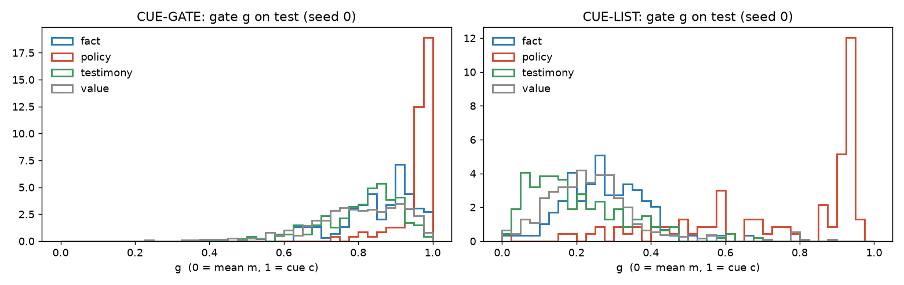
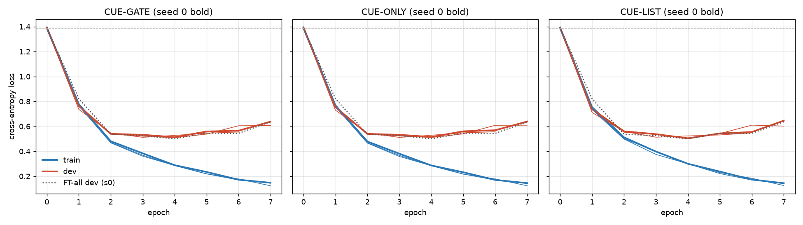
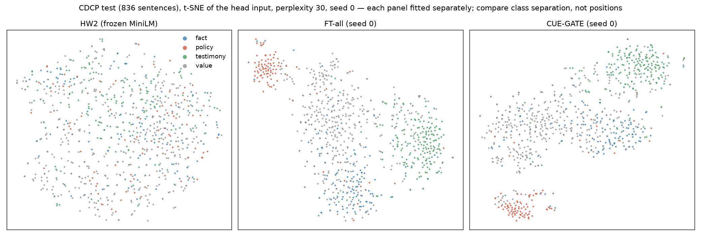

# HW3 experiment 2 — cue-preserving pooling with a learned gate
_Built 2026-11-07 15:06. Control = FT-all (results/hw3), same recipe; only pooling changes. Dev used only for early stopping; nothing chosen on test; test scored once per run. ± = std over seeds 0–2 (ddof 1). Interpretations are untested._

## 0. Checks and start state

- **Loop equivalence**: `train_cue` with `pool="mean"`, seed 0, reproduces FT-all seed 0 for epochs 0–2: max |diff| over train/dev loss, train/dev error and running train loss = 6.0e-08 → **pass**.
- FT-all dev error recomputed from saved weights: s0 0.1867 (saved 0.1867), s1 0.1886 (saved 0.1886), s2 0.1790 (saved 0.1790)

**Start state.** w = 0 makes the attention a_t uniform over word tokens, so at the start c = mean of word tokens *without* [CLS]/[SEP], whereas m includes them. The gate starts at g = sigmoid(0) = 0.5 (CUE-GATE, CUE-LIST), so z = (m + c)/2; in CUE-ONLY g = 1, so z = c. In CUE-LIST c = mean of list-word tokens (c = m when a sentence has none). So z is close to, but not exactly, FT-all's m at epoch 0. The head's initial weights, dropout masks and batch order are identical to FT-all's for the same seed (random state saved/restored around the new layers). The design was not changed to force equality.

| variant (seed 0) | epoch-0 dev loss | FT-all epoch-0 | ln 4 | max \|z − m\| | min cos(z, m) | dev sentences with a cue token |
|---|---|---|---|---|---|---|
| CUE-GATE | 1.3907 | 1.3905 | 1.3863 | 0.1842 | 0.9511 | 100% |
| CUE-ONLY | 1.3909 | 1.3905 | 1.3863 | 0.3049 | 0.8659 | 100% |
| CUE-LIST | 1.3882 | 1.3905 | 1.3863 | 0.1797 | 0.5722 | 48% |

_z and m are both L2-normalized (as the head sees them); max over dev sentences and dimensions._

Epoch-0 dev loss by seed (from each run's history):

| seed | FT-all | CUE-GATE | CUE-ONLY | CUE-LIST |
|---|---|---|---|---|
| 0 | 1.3905 | 1.3907 | 1.3909 | 1.3882 |
| 1 | 1.3882 | 1.3890 | 1.3898 | 1.3940 |
| 2 | 1.3905 | 1.3910 | 1.3913 | 1.3939 |

## 1. Occlusion check (FT-all seed 0, dev, before any training)

Delete the cue phrase; all four probabilities before and after.

| id | gold | deleted | | P(fact) | P(policy) | P(testimony) | P(value) | pred |
|---|---|---|---|---|---|---|---|---|
| dev-32.2 | fact | `It ' s important to understand that` | before | 0.075 | 0.009 | 0.003 | 0.912 | value |
|  |  |  | after | 0.841 | 0.012 | 0.034 | 0.112 | fact |
| dev-10.0 | testimony | `In my experience ,` | before | 0.014 | 0.001 | 0.036 | 0.949 | value |
|  |  |  | after | 0.032 | 0.001 | 0.011 | 0.956 | value |
| dev-71.3 | testimony | `My experience is` | before | 0.055 | 0.001 | 0.078 | 0.866 | value |
|  |  |  | after | 0.376 | 0.003 | 0.008 | 0.613 | value |
| dev-39.6 | policy | `be required to` | before | 0.051 | 0.919 | 0.008 | 0.022 | policy |
|  |  |  | after | 0.040 | 0.914 | 0.018 | 0.028 | policy |
| dev-47.2 | policy | `should not` | before | 0.003 | 0.992 | 0.001 | 0.005 | policy |
|  |  |  | after | 0.852 | 0.033 | 0.015 | 0.100 | fact |
| dev-8.9 | value | `should` | before | 0.003 | 0.990 | 0.001 | 0.007 | policy |
|  |  |  | after | 0.062 | 0.198 | 0.004 | 0.737 | value |
| dev-10.4 | policy | `should` | before | 0.008 | 0.977 | 0.002 | 0.012 | policy |
|  |  |  | after | 0.744 | 0.009 | 0.068 | 0.180 | fact |
| dev-41.2 | policy | `should` | before | 0.002 | 0.992 | 0.001 | 0.006 | policy |
|  |  |  | after | 0.008 | 0.842 | 0.006 | 0.144 | policy |

Notes on the edited sentences (text in occlusion.json, not committed):
- **dev-32.2**: grammatical; now starts with lower-case 'a'.
- **dev-10.0**: grammatical.
- **dev-71.3**: grammatical; reads as a general claim instead of a report.
- **dev-39.6**: grammatical fragment (it was already one); requirement becomes an action.
- **dev-47.2**: broken grammar ('They be allowed'); the negation is gone too.
- **dev-8.9**: broken grammar ('Judges be able').
- **dev-10.4**: broken grammar ('the letter say so').
- **dev-41.2**: broken grammar ('Starting the process be simple').

## 2. Test (CDCP, 836 sentences)

| metric | HW2 (n=3) | FT-all (n=3) | CUE-GATE (n=3) | CUE-ONLY (n=3) | CUE-LIST (n=3) |
|---|---|---|---|---|---|
| **test error** | 0.292 ± 0.005 | 0.223 ± 0.007 | 0.227 ± 0.007 | 0.226 ± 0.008 | 0.225 ± 0.009 |
| **macro-F1** | 0.649 ± 0.013 | 0.751 ± 0.003 | 0.745 ± 0.004 | 0.747 ± 0.005 | 0.748 ± 0.005 |
| fact P | 0.468 ± 0.009 | 0.540 ± 0.010 | 0.532 ± 0.011 | 0.537 ± 0.015 | 0.542 ± 0.012 |
| fact R | 0.458 ± 0.031 | 0.593 ± 0.022 | 0.585 ± 0.017 | 0.585 ± 0.017 | 0.588 ± 0.038 |
| **fact F1** | 0.463 ± 0.016 | 0.565 ± 0.005 | 0.557 ± 0.006 | 0.559 ± 0.005 | 0.563 ± 0.013 |
| policy P | 0.732 ± 0.043 | 0.819 ± 0.017 | 0.811 ± 0.040 | 0.808 ± 0.037 | 0.807 ± 0.009 |
| policy R | 0.534 ± 0.066 | 0.810 ± 0.006 | 0.806 ± 0.000 | 0.806 ± 0.000 | 0.810 ± 0.006 |
| **policy F1** | 0.614 ± 0.031 | 0.814 ± 0.006 | 0.808 ± 0.020 | 0.807 ± 0.019 | 0.809 ± 0.006 |
| testimony P | 0.737 ± 0.019 | 0.813 ± 0.020 | 0.817 ± 0.010 | 0.821 ± 0.011 | 0.808 ± 0.013 |
| testimony R | 0.761 ± 0.013 | 0.804 ± 0.022 | 0.788 ± 0.026 | 0.790 ± 0.025 | 0.807 ± 0.009 |
| **testimony F1** | 0.749 ± 0.005 | 0.808 ± 0.001 | 0.802 ± 0.011 | 0.805 ± 0.011 | 0.808 ± 0.008 |
| value P | 0.753 ± 0.009 | 0.824 ± 0.008 | 0.819 ± 0.008 | 0.819 ± 0.007 | 0.823 ± 0.003 |
| value R | 0.789 ± 0.010 | 0.807 ± 0.030 | 0.810 ± 0.026 | 0.812 ± 0.027 | 0.804 ± 0.025 |
| **value F1** | 0.771 ± 0.003 | 0.815 ± 0.012 | 0.814 ± 0.012 | 0.815 ± 0.012 | 0.813 ± 0.012 |

HW2 and FT-all are read from `results/hw3/` (not re-run).

### Confusion matrices, seed 0 (rows = gold)

**HW2**

| gold \ pred | fact | policy | testimony | value | recall |
|---|---|---|---|---|---|
| fact | 57 | 1 | 10 | 50 | 0.48 |
| policy | 8 | 51 | 5 | 29 | 0.55 |
| testimony | 12 | 3 | 142 | 30 | 0.76 |
| value | 47 | 17 | 33 | 341 | 0.78 |

**FT-all**

| gold \ pred | fact | policy | testimony | value | recall |
|---|---|---|---|---|---|
| fact | 69 | 2 | 7 | 40 | 0.58 |
| policy | 5 | 75 | 3 | 10 | 0.81 |
| testimony | 8 | 0 | 149 | 30 | 0.80 |
| value | 44 | 13 | 23 | 358 | 0.82 |

**CUE-GATE**

| gold \ pred | fact | policy | testimony | value | recall |
|---|---|---|---|---|---|
| fact | 69 | 3 | 6 | 40 | 0.58 |
| policy | 5 | 75 | 3 | 10 | 0.81 |
| testimony | 10 | 0 | 144 | 33 | 0.77 |
| value | 48 | 11 | 24 | 355 | 0.81 |

**CUE-ONLY**

| gold \ pred | fact | policy | testimony | value | recall |
|---|---|---|---|---|---|
| fact | 69 | 3 | 6 | 40 | 0.58 |
| policy | 5 | 75 | 3 | 10 | 0.81 |
| testimony | 10 | 0 | 145 | 32 | 0.78 |
| value | 47 | 12 | 24 | 355 | 0.81 |

**CUE-LIST**

| gold \ pred | fact | policy | testimony | value | recall |
|---|---|---|---|---|---|
| fact | 69 | 2 | 8 | 39 | 0.58 |
| policy | 5 | 75 | 3 | 10 | 0.81 |
| testimony | 8 | 0 | 153 | 26 | 0.82 |
| value | 43 | 15 | 25 | 355 | 0.81 |

## 3. Near-tie analysis (dev)

**Near ties (FT-all top-2 margin < 0.1)**, summed over seeds 0–2 (each variant seed vs FT-all same seed)

| variant | sentences | FT-all errors | fixed | broken | net | fact fixed/broken/n | policy fixed/broken/n | testimony fixed/broken/n | value fixed/broken/n |
|---|---|---|---|---|---|---|---|---|---|
| CUE-GATE | 60 | 35 | 12 | 9 | +3 | 3/3/14 | 1/1/5 | 5/0/17 | 3/5/24 |
| CUE-ONLY | 60 | 35 | 14 | 8 | +6 | 5/3/14 | 1/1/5 | 4/0/17 | 4/4/24 |
| CUE-LIST | 60 | 35 | 10 | 12 | -2 | 1/4/14 | 0/1/5 | 5/1/17 | 4/6/24 |

Per seed (n / FT-all errors / fixed / broken): CUE-GATE s0 20/13/5/2, s1 20/12/3/3, s2 20/10/4/4; CUE-ONLY s0 20/13/6/2, s1 20/12/4/3, s2 20/10/4/3; CUE-LIST s0 20/13/5/4, s1 20/12/0/3, s2 20/10/5/5

**All of dev (baseline)**, summed over seeds 0–2 (each variant seed vs FT-all same seed)

| variant | sentences | FT-all errors | fixed | broken | net | fact fixed/broken/n | policy fixed/broken/n | testimony fixed/broken/n | value fixed/broken/n |
|---|---|---|---|---|---|---|---|---|---|
| CUE-GATE | 1575 | 291 | 16 | 24 | -8 | 4/4/228 | 1/5/192 | 5/6/525 | 6/9/630 |
| CUE-ONLY | 1575 | 291 | 19 | 24 | -5 | 7/5/228 | 1/5/192 | 4/7/525 | 7/7/630 |
| CUE-LIST | 1575 | 291 | 17 | 28 | -11 | 1/5/228 | 0/8/192 | 6/4/525 | 10/11/630 |

Per seed (n / FT-all errors / fixed / broken): CUE-GATE s0 525/98/6/7, s1 525/99/5/9, s2 525/94/5/8; CUE-ONLY s0 525/98/7/9, s1 525/99/7/8, s2 525/94/5/7; CUE-LIST s0 525/98/6/9, s1 525/99/5/8, s2 525/94/6/11

## 4. Interpretability (seed 0, test — analysis only)

List words used for overlap: experience, i, important, must, my, need, needs, please, required, should ("to" from "need to" left out).

**CUE-GATE** (seed 0, test) — word most often given the highest a_t, per gold class (count, share of that class)

| rank | fact | policy | testimony | value |
|---|---|---|---|---|
| 1 | is (19, 16%) | **should** (58, 62%) | **i** (47, 25%) | is (74, 17%) |
| 2 | can (13, 11%) | **needs** (4, 4%) | was (17, 9%) | are (25, 6%) |
| 3 | are (9, 8%) | **must** (3, 3%) | we (10, 5%) | would (19, 4%) |
| 4 | have (8, 7%) | any (2, 2%) | have (10, 5%) | can (16, 4%) |
| 5 | and (5, 4%) | agree (2, 2%) | is (7, 4%) | **should** (13, 3%) |
| 6 | will (5, 4%) | **need** (2, 2%) | , (5, 3%) | and (10, 2%) |
| 7 | does (3, 2%) | is (2, 2%) | would (5, 3%) | **i** (9, 2%) |
| 8 | was (3, 2%) | possibly (1, 1%) | . (5, 3%) | have (9, 2%) |
| 9 | simply (2, 2%) | that (1, 1%) | could (3, 2%) | will (8, 2%) |
| 10 | don (2, 2%) | **please** (1, 1%) | **my** (3, 2%) | could (8, 2%) |
| 11 | just (2, 2%) | do (1, 1%) | has (3, 2%) | think (7, 2%) |
| 12 | may (2, 2%) | better (1, 1%) | did (3, 2%) | seems (6, 1%) |
| 13 | cannot (2, 2%) | make (1, 1%) | and (3, 2%) | it (6, 1%) |
| 14 | **i** (2, 2%) | to (1, 1%) | just (3, 2%) | not (5, 1%) |
| 15 | **must** (2, 2%) | then (1, 1%) | no (2, 1%) | want (5, 1%) |

Overlap with the word list (bold above): fact 2/15 (i, must); policy 5/15 (should, needs, must, need, please); testimony 2/15 (i, my); value 2/15 (should, i)

Gate g by gold class:

| gold | n | mean | median | q25–q75 | share g > 0.5 |
|---|---|---|---|---|---|
| fact | 118 | 0.858 | 0.883 | 0.805–0.927 | 100% |
| policy | 93 | 0.956 | 0.973 | 0.957–0.985 | 100% |
| testimony | 187 | 0.813 | 0.835 | 0.756–0.888 | 99% |
| value | 438 | 0.796 | 0.812 | 0.728–0.898 | 97% |

**CUE-ONLY** (seed 0, test) — word most often given the highest a_t, per gold class (count, share of that class)

| rank | fact | policy | testimony | value |
|---|---|---|---|---|
| 1 | is (19, 16%) | **should** (58, 62%) | **i** (34, 18%) | is (76, 17%) |
| 2 | can (13, 11%) | **needs** (4, 4%) | was (17, 9%) | are (24, 6%) |
| 3 | are (9, 8%) | **must** (3, 3%) | have (12, 6%) | would (18, 4%) |
| 4 | have (8, 7%) | any (2, 2%) | we (8, 4%) | can (17, 4%) |
| 5 | and (5, 4%) | agree (2, 2%) | is (8, 4%) | **should** (13, 3%) |
| 6 | will (5, 4%) | **need** (2, 2%) | , (6, 3%) | have (9, 2%) |
| 7 | does (3, 2%) | is (2, 2%) | would (5, 3%) | and (9, 2%) |
| 8 | was (3, 2%) | possibly (1, 1%) | has (5, 3%) | could (8, 2%) |
| 9 | simply (2, 2%) | that (1, 1%) | . (4, 2%) | it (8, 2%) |
| 10 | don (2, 2%) | **please** (1, 1%) | and (4, 2%) | think (7, 2%) |
| 11 | just (2, 2%) | do (1, 1%) | could (3, 2%) | will (7, 2%) |
| 12 | may (2, 2%) | better (1, 1%) | had (3, 2%) | **i** (6, 1%) |
| 13 | cannot (2, 2%) | make (1, 1%) | did (3, 2%) | seems (6, 1%) |
| 14 | **i** (2, 2%) | to (1, 1%) | then (3, 2%) | not (5, 1%) |
| 15 | **must** (2, 2%) | then (1, 1%) | just (3, 2%) | want (5, 1%) |

Overlap with the word list (bold above): fact 2/15 (i, must); policy 5/15 (should, needs, must, need, please); testimony 1/15 (i); value 2/15 (should, i)

(g is fixed to 1 in CUE-ONLY.)

**CUE-LIST** (seed 0, test) — word most often given the highest a_t, per gold class (count, share of that class)

| rank | fact | policy | testimony | value |
|---|---|---|---|---|
| 1 | **i** (9, 8%) | **should** (54, 58%) | **i** (102, 55%) | **i** (86, 20%) |
| 2 | **my** (4, 3%) | **needs** (4, 4%) | **my** (17, 9%) | **my** (16, 4%) |
| 3 | **must** (2, 2%) | **i** (4, 4%) | **required** (2, 1%) | **should** (12, 3%) |
| 4 | **required** (1, 1%) | **must** (3, 3%) |  | **must** (3, 1%) |
| 5 |  | **please** (1, 1%) |  | **experience** (1, 0%) |
| 6 |  | **my** (1, 1%) |  | to (1, 0%) |
| 7 |  | **required** (1, 1%) |  |  |
| 8 |  | to (1, 1%) |  |  |
| 9 |  | **need** (1, 1%) |  |  |
| 10 |  |  |  |  |
| 11 |  |  |  |  |
| 12 |  |  |  |  |
| 13 |  |  |  |  |
| 14 |  |  |  |  |
| 15 |  |  |  |  |

Overlap with the word list (bold above): fact 4/15 (i, my, must, required); policy 8/15 (should, needs, i, must, please, my, required, need); testimony 3/15 (i, my, required); value 5/15 (i, my, should, must, experience)

Share of test sentences with ≥1 list word: fact 14%, policy 75%, testimony 65%, value 27%. Sentences without one use z = m.

Gate g by gold class:

| gold | n | mean | median | q25–q75 | share g > 0.5 |
|---|---|---|---|---|---|
| fact | 118 | 0.277 | 0.263 | 0.197–0.346 | 3% |
| policy | 93 | 0.732 | 0.873 | 0.569–0.933 | 80% |
| testimony | 187 | 0.201 | 0.168 | 0.101–0.276 | 2% |
| value | 438 | 0.241 | 0.229 | 0.163–0.292 | 3% |

## 5. Training

| run | trainable params | best epoch | last epoch | stop | train s/epoch | dev loss | dev error | min |
|---|---|---|---|---|---|---|---|---|
| ft_all_seed0 (HW3) | 22,615,172 | 4 | 7 | early_stop | — | 0.5005 | 0.187 | — |
| ft_all_seed1 (HW3) | 22,615,172 | 3 | 6 | early_stop | — | 0.5064 | 0.189 | — |
| ft_all_seed2 (HW3) | 22,615,172 | 4 | 7 | early_stop | — | 0.4984 | 0.179 | — |
| cue_gate_seed0 | 22,616,325 | 4 | 7 | early_stop | 19 | 0.5134 | 0.189 | 2.6 |
| cue_gate_seed1 | 22,616,325 | 3 | 6 | early_stop | 19 | 0.5122 | 0.196 | 2.2 |
| cue_gate_seed2 | 22,616,325 | 4 | 7 | early_stop | 18 | 0.5092 | 0.185 | 2.5 |
| cue_only_seed0 | 22,615,556 | 4 | 7 | early_stop | 18 | 0.5148 | 0.190 | 2.5 |
| cue_only_seed1 | 22,615,556 | 3 | 6 | early_stop | 19 | 0.5115 | 0.190 | 2.1 |
| cue_only_seed2 | 22,615,556 | 4 | 7 | early_stop | 18 | 0.5109 | 0.183 | 2.5 |
| cue_list_seed0 | 22,615,941 | 4 | 7 | early_stop | 19 | 0.5042 | 0.192 | 2.5 |
| cue_list_seed1 | 22,615,941 | 3 | 6 | early_stop | 18 | 0.5132 | 0.194 | 2.1 |
| cue_list_seed2 | 22,615,941 | 4 | 7 | early_stop | 18 | 0.5071 | 0.189 | 2.4 |

## 6. Map

t-SNE (perplexity 30, PCA init, random_state 0) of the 384-d head input: HW2 = frozen MiniLM embedding (cache), FT-all and CUE-GATE = fine-tuned z. Each panel is fitted separately, so axes and positions are not comparable across panels.

## 7. Interpretation (untested)

Hand-written, in [`interpretation.md`](interpretation.md) (not regenerated by this script).
